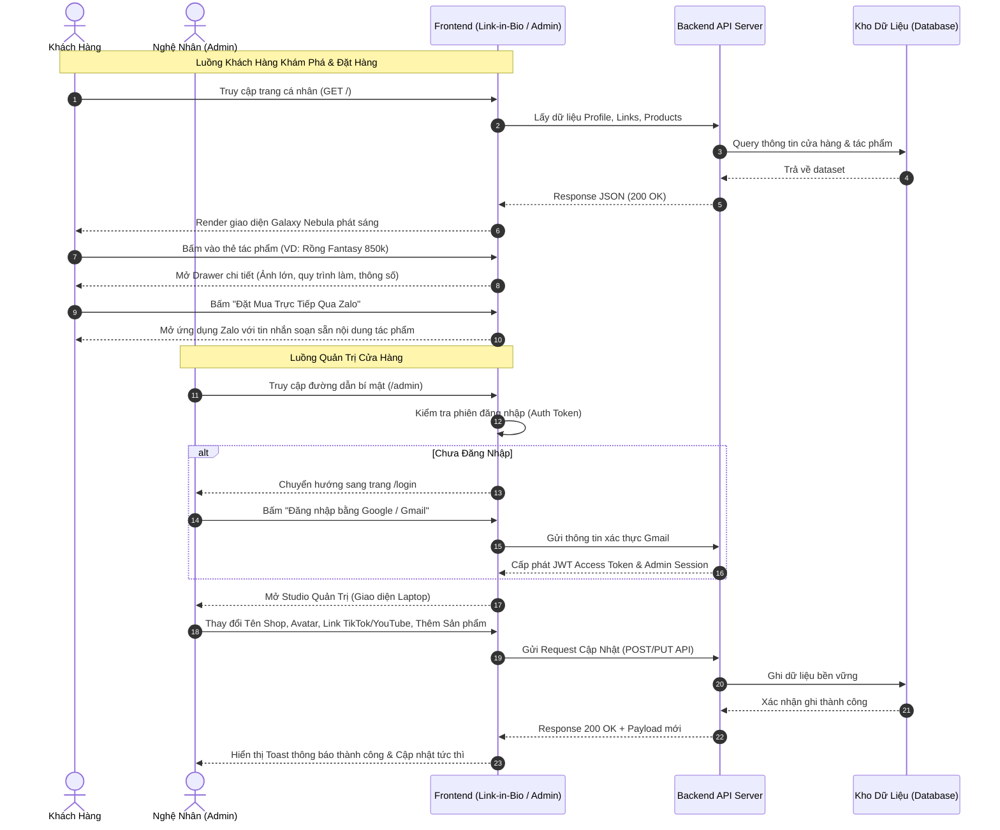

# 01. BẢNG MÔ TẢ KIẾN TRÚC NGHIỆP VỤ & QUY TRÌNH HỆ THỐNG
## Dự Án: Luna Handmade — Galaxy Nebula Storefront Platform

---

## 1. TỔNG QUAN HỆ THỐNG & ĐỐI TƯỢNG TÁC ĐỘNG

Hệ thống **Luna Handmade** bao gồm 2 phân hệ người dùng chính:
1. **Khách hàng vãng lai / Người mua sắm (End-User / Art Collector):**
   - Truy cập vào trang web thông qua link bio trên mạng xã hội (TikTok, Instagram, Facebook, YouTube, Zalo).
   - Tiếp cận nhận diện thương hiệu nghệ nhân độc bản phong cách Galaxy Nebula Dark.
   - Bấm vào các liên kết điều hướng đa kênh hoặc bấm vào các tác phẩm thủ công tiêu biểu để xem chi tiết thông số và bấm đặt mua 1:1 qua Zalo/Hotline.
2. **Nghệ nhân sáng tạo / Quản trị viên (Creator / Shop Admin):**
   - Đăng nhập bảo mật vào hệ thống thông qua tài khoản Gmail quản trị.
   - Sử dụng bảng điều khiển quản trị (Creator Studio) thiết kế chuẩn màn hình máy tính (Laptop-First) để cập nhật thông tin cửa hàng, thay đổi ảnh đại diện, chỉnh sửa link mạng xã hội, đăng tải tác phẩm mới và cập nhật câu chuyện nghệ nhân.

---

## 2. QUY TRÌNH NGHIỆP VỤ CỐT LÕI (CORE BUSINESS PROCESSES)

---

## 3. CÁC QUY TẮC NGHIỆP VỤ BẮT BUỘC (BUSINESS RULES - BR)

### 3.1. Quy tắc Xác thực & Phân quyền (BR-AUTH)
* **BR-AUTH-01:** Trang người dùng (`/`) hoàn toàn công khai, không yêu cầu bất kỳ bước đăng nhập nào để đảm bảo tỷ lệ chuyển đổi cao nhất cho khách hàng.
* **BR-AUTH-02:** Trang quản trị (`/admin`) là trang kín, bắt buộc phải có phiên đăng nhập hợp lệ với định danh Gmail Admin (role: `ADMIN`).
* **BR-AUTH-03:** Phiên làm việc quản trị được duy trì an toàn thông qua JWT Token (Access Token lưu trữ tại Header Bearer / Cookie an toàn).
* **BR-AUTH-04:** Khi phiên đăng nhập hết hạn hoặc người dùng chủ động bấm "Đăng xuất", toàn bộ token và thông tin phiên lưu tạm phải được xóa bỏ và điều hướng về `/login`.

### 3.2. Quy tắc Định danh Cửa hàng & Nghệ nhân (BR-PROFILE)
* **BR-PROFILE-01:** Tên Shop (`name`) là trường bắt buộc, độ dài từ 2 đến 60 ký tự, không được để trống.
* **BR-PROFILE-02:** Ảnh đại diện (`avatar`) hỗ trợ 2 định dạng: URL trực tuyến (bắt đầu bằng `http://` hoặc `https://`) hoặc File hình ảnh tải lên từ máy (`image/jpeg`, `image/png`, `image/webp`) với dung lượng tối đa 5MB.
* **BR-PROFILE-03:** Khi ảnh đại diện được cập nhật, hệ thống phải tự động bọc vòng hào quang phát sáng 3 màu (`#c9184a`, `#7209b7`, `#0077b6`) và gắn huy hiệu nghệ nhân xác minh (Verified Badge).
* **BR-PROFILE-04:** Câu chuyện "Một chút về mình" (`aboutStory`) cho phép độ dài tối đa 1.000 ký tự, nhằm truyền tải thông điệp niềm đam mê thủ công và quy trình đóng gói quà tặng.

### 3.3. Quy tắc Hệ thống Liên kết Mạng Xã Hội (BR-LINK)
* **BR-LINK-01 (Nút Hero Storefront):** Nút "CỬA HÀNG THỦ CÔNG LUNA" luôn được ghim ở vị trí đầu tiên của danh sách, sở hữu viền phát quang chuyển màu loang nổi bật nhất và đèn live ping nhấp nháy.
* **BR-LINK-02 (Kênh tích hợp sẵn):** Hệ thống tối ưu hóa trực tiếp cho các nền tảng: **TikTok, YouTube, Facebook, Instagram, Zalo, Telegram**. Nếu nghệ nhân xóa trắng URL của một kênh, nút của kênh đó sẽ tự động ẩn trên trang người dùng mà không làm vỡ bố cục.
* **BR-LINK-03 (Liên kết tùy chỉnh):** Cho phép bổ sung không giới hạn các liên kết mở rộng (Shopee, Lazada, Website cá nhân, Portfolio), hỗ trợ bật/tắt trạng thái hiển thị (`enabled: true/false`) và đổi thứ tự hiển thị (`order`).

### 3.4. Quy tắc Quản lý Danh mục Tác phẩm (BR-PRODUCT)
* **BR-PRODUCT-01:** Tác phẩm phải có Tên (`title`), Giá bán (`price` hoặc `priceDisplay`), và Ảnh tác phẩm (`image`).
* **BR-PRODUCT-02 (Hệ thống Badge Dạ Quang):** Mỗi tác phẩm được gán 1 trong các huy hiệu trạng thái:
  - `Hot`: Viền đỏ rượu vang phát sáng (`#c9184a`), áp dụng cho tác phẩm bán chạy nhất.
  - `New`: Viền xanh đại dương dạ quang (`#00b4d8`), áp dụng cho tác phẩm mới hoàn thiện.
  - `Mini`: Viền tím thiên hà pastel (`#d946ef`), áp dụng cho tượng nhỏ/móc khóa.
  - `Custom`: Viền vàng kim tinh tú (`#facc15`), áp dụng cho đơn đặt làm theo yêu cầu 1:1.
* **BR-PRODUCT-03 (Luồng Đặt Hàng Chuyển Đổi):** Khi khách bấm vào sản phẩm, hệ thống mở cửa sổ chi tiết (Drawer/Modal) kèm nút **"Đặt Mua Trực Tiếp (Zalo 1:1)"**. Khi bấm, hệ thống tạo sẵn liên kết Zalo URL kèm câu chào định sẵn chứa tên tác phẩm và mức giá để khách gửi đi nhanh chóng.

### 3.5. Quy tắc Lưu trữ & Đồng bộ Dữ liệu (BR-SYNC)
* **BR-SYNC-01:** Khi nghệ nhân lưu bất kỳ thay đổi nào trên trang Admin, dữ liệu được ghi nhận đồng thời vào Cơ sở dữ liệu Backend và đồng bộ thời gian thực đến trang người dùng.
* **BR-SYNC-02 (Sao lưu dự phòng):** Hệ thống cung cấp tính năng Xuất (Export) và Nạp (Import) dữ liệu cấu hình trọn gói dưới định dạng file JSON tiêu chuẩn.
