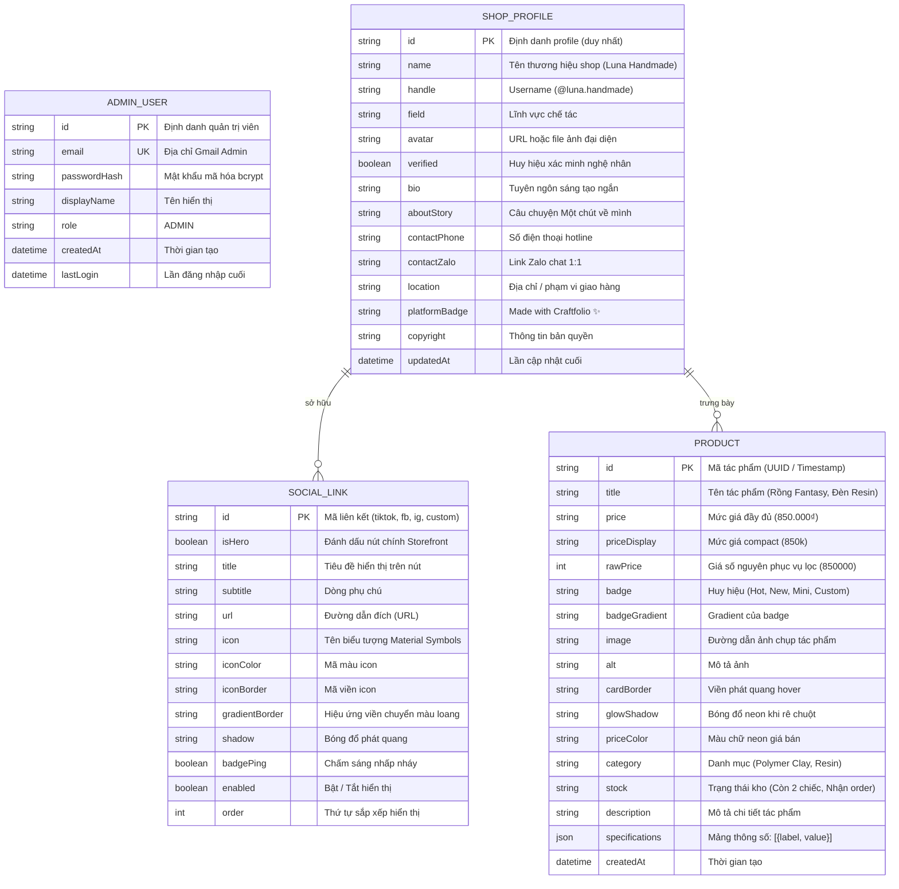

# 04. THIẾT KẾ MÔ HÌNH DỮ LIỆU (DATABASE SCHEMA)
## Dự Án: Luna Handmade — Galaxy Nebula Architecture

---

## 1. SƠ ĐỒ THỰC THỂ QUAN HỆ (ENTITY RELATIONSHIP DIAGRAM)

---

## 2. CHI TIẾT CÁC BẢNG DỮ LIỆU

### 2.1. Bảng `SHOP_PROFILE` (Thông tin Cửa hàng)
| Trường (Field) | Kiểu Dữ Liệu | Ràng Buộc | Mô Tả |
| :--- | :--- | :--- | :--- |
| `id` | `VARCHAR(36)` | `PRIMARY KEY` | Khóa chính |
| `name` | `VARCHAR(100)` | `NOT NULL` | Tên Shop ("Luna Handmade") |
| `handle` | `VARCHAR(50)` | `NOT NULL` | Tên người dùng ("@luna.handmade") |
| `field` | `VARCHAR(100)` | `NULLABLE` | Lĩnh vực ("Nghệ thuật thủ công & Resin") |
| `avatar` | `TEXT` | `NOT NULL` | Đường dẫn ảnh đại diện hoặc base64 |
| `verified` | `BOOLEAN` | `DEFAULT TRUE` | Trạng thái tích xanh xác minh |
| `bio` | `TEXT` | `NULLABLE` | Khẩu hiệu ngắn dưới tên shop |
| `aboutStory` | `TEXT` | `NULLABLE` | Đoạn văn "Một chút về mình" |
| `contactPhone` | `VARCHAR(20)`| `NULLABLE` | Hotline tư vấn |
| `contactZalo` | `TEXT` | `NULLABLE` | Link nhắn tin Zalo |
| `location` | `VARCHAR(150)`| `NULLABLE` | Khu vực hoạt động |

### 2.2. Bảng `SOCIAL_LINK` (Liên kết Mạng xã hội)
| Trường | Kiểu | Ràng Buộc | Mô Tả |
| :--- | :--- | :--- | :--- |
| `id` | `VARCHAR(50)` | `PRIMARY KEY` | Mã định danh (`tiktok`, `youtube`, ...) |
| `isHero` | `BOOLEAN` | `DEFAULT FALSE`| Nút Storefront nổi bật trên cùng |
| `title` | `VARCHAR(100)` | `NOT NULL` | Tên nút hiển thị |
| `subtitle` | `VARCHAR(150)` | `NULLABLE` | Dòng mô tả nhỏ bên dưới |
| `url` | `TEXT` | `NOT NULL` | Đường dẫn đích đến |
| `icon` | `VARCHAR(50)` | `NOT NULL` | Tên icon Material Symbols |
| `enabled` | `BOOLEAN` | `DEFAULT TRUE` | Có hiển thị trên trang khách hay không |
| `order` | `INT` | `DEFAULT 0` | Số thứ tự sắp xếp |

### 2.3. Bảng `PRODUCT` (Danh mục Tác phẩm)
| Trường | Kiểu | Ràng Buộc | Mô Tả |
| :--- | :--- | :--- | :--- |
| `id` | `VARCHAR(50)` | `PRIMARY KEY` | Mã sản phẩm duy nhất |
| `title` | `VARCHAR(150)` | `NOT NULL` | Tên tác phẩm thủ công |
| `priceDisplay` | `VARCHAR(30)` | `NOT NULL` | Giá hiển thị ngắn gọn (`850k`) |
| `price` | `VARCHAR(50)` | `NULLABLE` | Giá đầy đủ (`850.000₫`) |
| `badge` | `VARCHAR(20)` | `DEFAULT 'New'`| Tag trạng thái (*Hot, New, Mini, Custom*) |
| `image` | `TEXT` | `NOT NULL` | Đường dẫn hình ảnh chất lượng cao |
| `category` | `VARCHAR(50)` | `NULLABLE` | Phân loại thể loại nghệ thuật |
| `stock` | `VARCHAR(50)` | `NULLABLE` | Tình trạng còn hàng / số lượng |
| `description` | `TEXT` | `NULLABLE` | Mô tả quy trình chế tác |
| `specifications`| `JSON` | `NULLABLE` | Mảng thông số `[{ label, value }]` |
